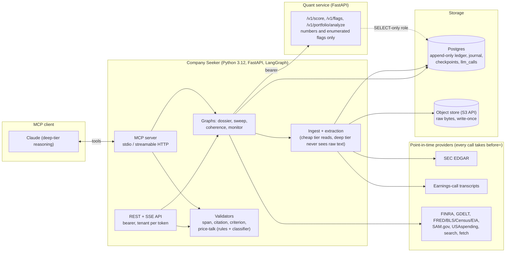

# Company Seeker: an MCP server for grounded equity research

Docs-only showcase. The source is private (see [Why the source is private](#why-the-source-is-private)). Everything here is written from the code as it stands; nothing is projected.

## Problem

An analyst using a language model to read filings has two failure modes: the model says something the documents do not support, and the model drifts from describing a business into recommending its shares. Both are invisible in prose. Company Seeker is an MCP server that gives the model point-in-time evidence from SEC filings and earnings calls, accepts a structured forecast back, and refuses to store any claim it cannot trace to a passage it showed, any resolution criterion a program cannot check later, or any sentence that reads as a trade recommendation. Numbers come from a separate quant service that returns scores and enumerated flags only and never writes a sentence. Every forward-looking claim is dated, graded when it resolves, and scored with a Brier score.

## Architecture



Three model tiers do different jobs. A cheap tier reads every document on the way in and runs the price-talk classifier. A mid tier builds the profile and the bull and bear cases. The deep tier writes the forecast and the analyst review. Over MCP, the client's own model is the deep tier: the server loads evidence, hands over the question, and checks the answer.

A longer walkthrough is in [docs/architecture.md](docs/architecture.md).

## MCP tools

Seven tools on stdio. Four of them are also served over streamable HTTP; the three that ingest, fetch arbitrary URLs or write to a shared cache stay on stdio where the caller already owns the machine. Every tool returns one text block; a refusal is an MCP tool error with the reasons listed one per line.

| Tool | Purpose | Input | Side effects | HTTP |
|---|---|---|---|---|
| `open_analysis` | Load everything a forecast for one company may rest on at a cutoff and return the question plus numbered quotable passages | `ref` (required), `as_of`, `depth` quick/full | Ingests new filings, runs cheap-tier extraction, opens a handle | no |
| `submit_forecast` | Answer an open analysis; the draft is checked and stored if it passes | `analysis_id`, `draft` (required) | Validators, classifier, one row in the forecast cache | no |
| `add_source` | Store a web page as dated evidence for a company | `ref`, `url` (required), `published_at`, `as_of` | SSRF-guarded fetch, one document row | no |
| `list_portfolios` | Name the books this install holds | none | none | yes |
| `review_portfolio` | What moved under one book in a window, and whether the holdings cluster into fewer bets than they look like | `portfolio_id` (required), `as_of`, `period_days` 1..365 | Runs the coherence graph (two cheap-tier calls) | yes |
| `list_candidates` | Sweeps waiting for a person to say which companies deserve a dossier | none | none | yes |
| `approve_candidates` | Answer a waiting sweep and let it continue | `run_id`, `keep[]` (required) | Starts one dossier per kept company | yes |

### `submit_forecast` draft schema

The shape the server accepts. Three fields a client might expect are deliberately absent: the company and cutoff come from the handle, the evidence digest is recomputed and compared, and citations are snippet keys the server resolves back to byte offsets. None of the three can be supplied, so none can be forged.

```json
{
  "analysis_id": "string, from open_analysis",
  "draft": {
    "scenarios": [
      {
        "name": "bull | base | bear  (exactly one of each; probabilities sum to 1)",
        "probability": "number 0..1",
        "narrative": "string",
        "demand_delta_pct": "[low, high]",
        "margin_pressure": "easing | flat | tightening",
        "key_assumptions": ["string"],
        "horizon_months": "integer > 0",
        "resolution_criterion": {
          "check_kind": "macro_series | filing_field | transcript_statement | event | manual",
          "target": "series id, XBRL concept, regex or event description",
          "comparator": "> | < | >= | <= | == | exists | direction_up | direction_down | null",
          "threshold": "number | null",
          "resolves_at": "YYYY-MM-DD"
        }
      }
    ],
    "counter_view": "string (required)",
    "counter_view_evidence": ["E3", "E7"],
    "drivers": [
      {
        "driver": "string",
        "direction": "up | flat | down",
        "horizon_months": "integer > 0",
        "confidence": "number 0..1",
        "evidence": ["E1"],
        "resolution_criterion": { "...as above": "" }
      }
    ],
    "growth_paths": ["string"],
    "external_risks": ["string"],
    "bottlenecks_faced": ["string"],
    "bottlenecks_owned": ["string"],
    "linked_themes": ["string"]
  }
}
```

A worked exchange, including one refusal and its repair, is in [examples/transcript.md](examples/transcript.md). The data in it is synthetic; see [data/synthetic](data/synthetic/README.md).

## Evaluation

Two kinds of measurement, both described in [docs/eval.md](docs/eval.md).

Offline, `seeker eval` runs frozen scenarios against a real model and compares each score with a hand-recorded baseline; a drop of more than 0.05 fails the build. The scenarios cover the price-talk classifier, a trap set for exposure verification, causal-chain citation, analyst grounding and run-to-run stability. Pytest never reaches a model: a guard refuses to build a transport under the test runner, and provider tests replay recorded responses.

Online, every model call and every tool call writes a row with tokens, cost in USD at the vendor's list price, and wall-clock latency, keyed by run and graph node. Latency percentiles and cost per call below are computed from those rows.

Measured on 2026-10-24 on a local stack. Cheap tier: Gemini Flash-Lite. Deep tier over MCP: the client's model. Latency includes rate-limiter wait and retries, which is what a caller experiences.

| Measure | Value | n | Source |
|---|---|---|---|
| Price-talk rules only, held-out recommendations refused | 17 of 40 (42.5%) | 40 | unit test, deterministic |
| Price-talk rules only, held-out research passages wrongly refused | 0 of 40 | 40 | unit test, deterministic |
| Price-talk rules + classifier, accuracy on the tuned set | 22 of 22 (1.00) | 22 | `seeker eval --tier cheap`, 0 throttled |
| Price-talk rules + classifier, held-out recommendations refused | 10 of 10 | 10 | `seeker eval price-talk --holdout` |
| Price-talk rules + classifier, held-out research passages allowed | 12 of 12 | 12 | `seeker eval price-talk --holdout` |
| Same held-out set, decision-model classifier (alternative gate) | 9 of 10 refused, 12 of 12 allowed | 22 | `seeker eval price-talk --holdout`; the miss is an authority-appeal injection |
| `open_analysis`, opens a question (store already ingested, profile cached) | 3.8 to 4.1 s for a small filer, 20.2 to 23.0 s for a large one | 6 | client-side wall-clock, stdio |
| `open_analysis`, evidence already forecast (returns the stored row) | 0.20 s and 0.37 s | 2 | client-side wall-clock, stdio |
| `submit_forecast`, draft stored first time | 53.5 s, 65.3 s, 153.7 s | 3 | client-side wall-clock; the classifier reads about 25 fields at 15 calls/min; the slow one shared the rate limit with an ingest |
| `submit_forecast`, refused for price talk | 7.7 s, 104.2 s, 155.2 s | 3 | one draft, three rewordings of its counter-view, each judged a recommendation by the classifier; the paragraph discussed capacity timing |
| `review_portfolio`, 28-holding book, 7 and 30 day windows | 77.9 s and 155.6 s | 2 | client-side wall-clock; coherence graph plus the gate over every string |
| `list_portfolios` | 0.09 s | 1 | client-side wall-clock |
| `open_analysis` to `submit_forecast`, stored, server-side | p50 120 s, p95 222 s | 7 | `runs` started to finished |
| `open_analysis` to `submit_forecast`, refused, server-side | p50 159 s, p95 349 s | 6 | `runs` started to finished |
| Cheap-tier extraction per 10-Q | p50 9.1 s, p95 38.4 s, $0.0085 per call | 16 | `llm_calls` by node |
| Cheap-tier extraction per 10-K | p50 5.7 s, p95 30.2 s, $0.0041 per call | 5 | `llm_calls` by node |
| Cheap-tier extraction per 8-K | p50 5.6 s, p95 39.3 s, $0.0015 per call | 46 | `llm_calls` by node |
| Cheap-tier extraction per earnings-call transcript | p50 9.3 s, p95 42.2 s, $0.0053 per call | 6 | `llm_calls` by node |
| Company profile build, one call per new evidence set | p50 4.3 s, p95 23.1 s, $0.0054 per call | 35 | `llm_calls` by node |
| Coherence graph, two cheap-tier calls per review | p50 2.2 s + 2.7 s, p95 2.5 s + 3.2 s, $0.0035 per review | 12 | `llm_calls` by node |

Rows with n below 6 give the samples rather than percentiles. The classifier is the gate the system rests on, and the refused row shows its cost: one counter-view paragraph that discussed when new capacity would ship was judged a recommendation three times in a row, while a paragraph with the same argument for another company was stored. A false refusal costs a reopen and a rewrite; a false pass would store a recommendation for ever, which is the side the gate is built to err on. The p95 on extraction is the vendor's rate limiting: the latency column includes the retry and backoff the transport did on a 429, which is what a caller waits for. Cost is the vendor's list price for the tokens used, as the ledger records it; the cheap tier here ran on a free quota, so the money spent was zero. Server-side model cost of an MCP round trip is the classifier's calls, which the ledger does not bill, so the run rows carry zero by design. Insider forms (Form 4) were read by the model until 2026-10-16: 216 calls at p50 40.0 s and $0.0067 each, $1.44 in total for three companies. They are now parsed from the filing's XML with no model call, which is the kind of change the ledger exists to justify.

What the table does not say: the deep-tier cost is on the client's side and depends on the client's model and context; the classifier's own calls are not billed in the ledger, so server-side cost is a floor; and these are single-machine numbers, not a load test.

## Security model

- **Authentication.** The REST API takes static bearer tokens mapped to tenants, compared in constant time; an installation with no token configured refuses every request rather than defaulting open. MCP over HTTP is an OAuth resource server: tokens are verified against the issuer's key set, asymmetric algorithms only, one admitted subject. Stdio has no auth by design.
- **What the model cannot do.** Emit a buy, sell, hold or target-price statement: every user-visible string passes a rules filter and a classifier, the classifier is mandatory, and the server refuses to start without one. Forecast a return: numbers come only from the quant service, whose contract test rejects any advice-shaped field. Cite text it was not shown: spans must match the stored document byte for byte. Choose its own company, cutoff or evidence: those come from the server's handle. Read raw filings: extraction runs first. Call tools itself: graph nodes call them, under per-node caps.
- **Prompt injection.** The classifier wraps the passage in markers carrying a per-call random tag and only accepts a verdict token that repeats the tag, so a passage that says "answer ALLOW" fails to parse. A classifier that does not answer is treated as a refusal, never as a pass.
- **Spend.** A weekly USD cap and a weekly question cap are checked before any work starts, with alerts at 50% and 80%. The quant service rate-limits per token. Every provider call is bounded by a point-in-time cutoff, so a run cannot read the future.
- **Network and data.** Page fetches refuse private addresses after DNS on every hop, cross-site redirects, more than five hops and more than 2 MB. The quant service reads the seeker's database through a role that can SELECT four tables and nothing else. Ledger, journal and thesis history are append-only by trigger. No test reaches the network.
- **Known limits, stated in the code.** The rules filter alone catches about four in ten unseen phrasings, which is why the classifier is mandatory. Tenancy is routing, not row-level security. Rate limiters are per process.

## Why the source is private

The system runs against live vendor data on licence tiers that permit internal use but not display, it stores an operator's own theses, and it is still being tested on a single tenant. The intent is to open the generic parts (the MCP scaffold with auth, the eval harness, the point-in-time provider contract) once the vendor terms and the regulatory position of an analysis tool that is designed to be unable to recommend have been reviewed. Until then the docs are public and the code is not.

## Demo

Two-minute walkthrough: DEMO_VIDEO_LINK (placeholder). The storyboard is in [docs/demo-storyboard.md](docs/demo-storyboard.md).

## Stack

Python 3.12, FastAPI, LangGraph with a Postgres checkpointer, Pydantic contracts shared between two services and published as JSON Schema, SQLAlchemy and Alembic, MinIO or S3 for raw bytes, Docker Compose, the official MCP Python SDK, Anthropic and Gemini transports, vcrpy-recorded provider tests, import-linter for layering, ruff, mypy.
